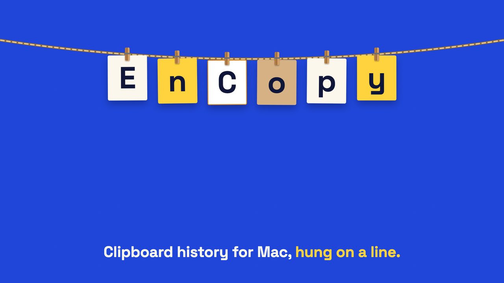
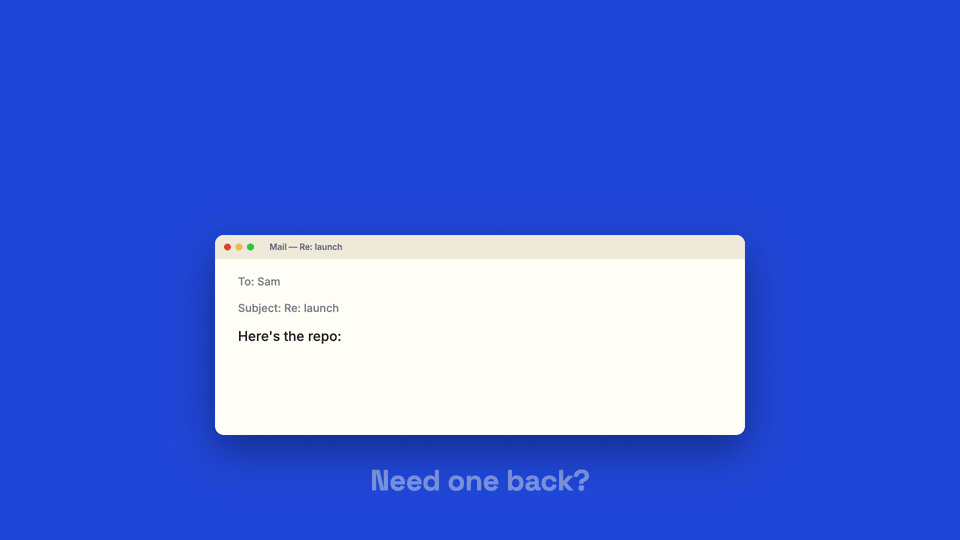
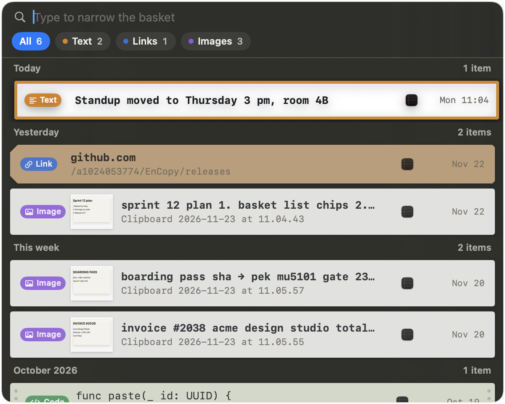
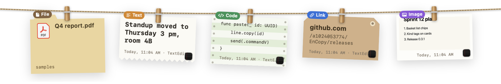
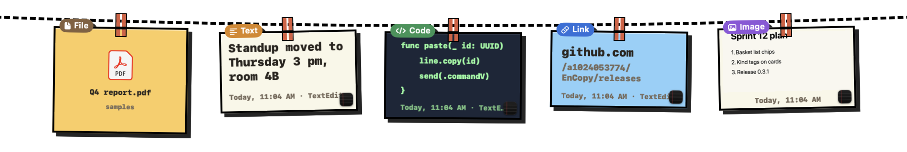
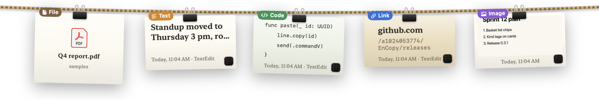
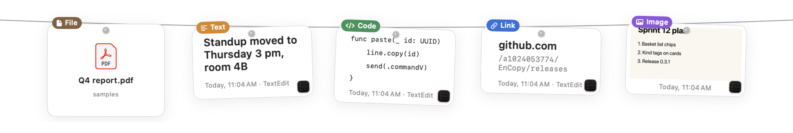
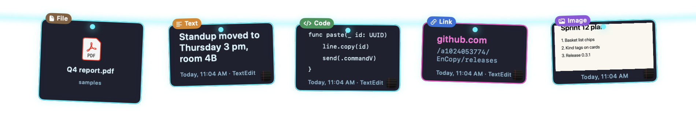
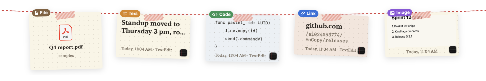
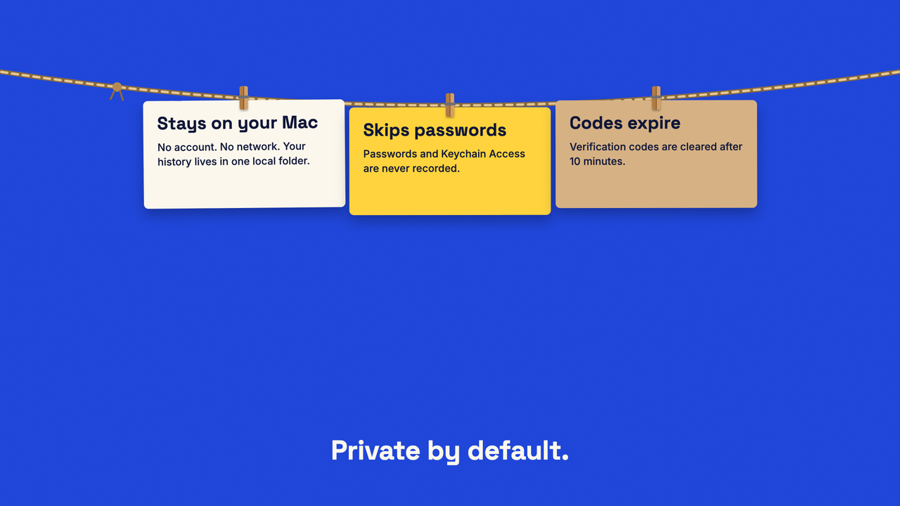

# EnCopy

[简体中文](README.md) | English

<p align="center"><a href="https://a1024053774.github.io/EnCopy/"></a></p>

EnCopy is a clipboard app for macOS: what you copy and your screenshots hang on a line at the top of the screen; press ⌥C to bring the line down, pick an item with the keyboard, and paste it back where you were typing. Product page: <https://a1024053774.github.io/EnCopy/>. You can try ⌥C right on the page and watch a 40-second demo. The demo is also a video: [EnCopy-intro.mp4](promo/EnCopy-intro.mp4) (39 seconds, with sound).

It is a modified version of Alejandro Buján's [Tendedero](https://github.com/alejandrobujan/tendedero) (upstream `3c5b575`, 2.0.0, MIT license). EnCopy is an independent project with its own name and icon. It is not affiliated with or endorsed by Tendedero or its author.

## Download

The latest version is [0.3.2](https://github.com/a1024053774/EnCopy/releases/latest). Download [EnCopy.dmg](https://github.com/a1024053774/EnCopy/releases/latest/download/EnCopy.dmg) and drag EnCopy into Applications. Requires macOS 14 or later; runs on Apple silicon and Intel.

This version is not notarized by Apple, so macOS blocks it the first time you open it: go to System Settings → Privacy & Security and click Open Anyway. To paste directly with ⏎, turn on EnCopy in System Settings → Privacy & Security → Accessibility.

## Features

### ⌥C, pick one, paste it back



Press ⌥C and the line drops onto the screen the pointer is on and takes the keyboard; ← → picks an item, and ⏎ pastes it back into the front app. Pasting directly needs the Accessibility permission; without it, ⏎ only copies, and you press ⌘V. Double-clicking a card pastes it too.

⌥C is the only global shortcut. Every other key works only while the line has the keyboard: Tab shows one kind (text, links, images, files), ⇧⏎ pastes words only, ⌘Y opens Quick Look, ⌘P pins.

### Copy, and it hangs: one paper per kind


Text, links and code you copy are recorded out of the box, files copied in Finder hang on the line too (only their paths are kept, nothing is copied; several copied at once are one "N files" card that pastes them all back) and go into the basket when they fall, and you can pause recording from the menu bar. Screenshots can be handed to it as well: a screenshot hangs on the line the moment you take it.

- Text is a receipt, code is tractor-feed paper, a link is a kraft tag, an image is a polaroid, a file is a folder; wooden pegs and two-strand twine. Each card carries a kind tag in its top corner (text, code, link, image, video, file), one colour per kind. Each card shows the icon of the app it was copied from, which you can turn off.
- Pinned items hang left of the knot; the newest hangs first right of the knot, older ones further right.
- An item you paste or copy out goes back to the head of the line, so the next ⌥C picks it first. Copying the same content again adds no new item and brings the existing one back to the head; the same goes for copying the same picture again, which is not saved twice.
- When something new is copied, the line peeks out for 1.5 seconds; set it from 0.8 to 4 seconds in Settings → The line, or turn it off.
- Everything is still there after you quit and reopen.

### Type to search, the basket included



When the line is full, the oldest item falls into the basket instead of the Trash; screenshots and copied images that EnCopy keeps do too. After ⌥C, typing searches all the text on the line and in the basket, and ⏎ pastes the picked result:

- Pictures are found by the text read from them; pictures and videos from Finder by their file names.
- After ⌥C, a basket handle hangs at the lower right of the line: "Basket N ↓". Press ↓ or click it and the basket opens as a list, newest first all the way back, grouped by today, yesterday, this week, then by month; each row is a strip of its own paper, in the theme; chips above the list, "All / Text / Links / Images" with counts, narrow it by kind. ↑↓ go row by row, ← → jump a group, typing and Tab narrow the list, ⏎ pastes, ⌘P pins it back on the line.

### Six themes

Paper, Pixel, Skeuomorphic, Minimal, Neon and Journal. Papers, pegs and the rope change together; pick one in Settings → The line.

| Paper | Pixel |
| --- | --- |
|  |  |
| **Skeuomorphic** | **Minimal** |
|  |  |
| **Neon** | **Journal** |
|  |  |

### What it keeps, and for how long



- Each app can be set to record as usual, clear after an hour, or not record; Passwords and Keychain Access are not recorded by default. Verification codes clear after 10 minutes, and one thrown away early is not left in the Trash.
- Text and files from Finder are kept for a year; screenshot originals shrink to thumbnails after 30 days and their text stays searchable; when originals pass the cap (1 GB by default), the oldest shrink first. All of it is on the Keeping page in Settings, where you set the cap and see how much originals take and what the next run will clear.
- Expired items go to Recently Cleared first and can be put back in batches for 7 days. Clean Up History… in the menu bar clears a batch by kind, age, app or text.

### Motion

Motion follows the design's table: papers swing by weight, ⌥C and sliding down past the top edge each have their own spring, and a breeze passes now and then; with Reduce motion on, only fades remain. The menu bar glyph is a rope with two pegs.

## Build

Requires the Swift toolchain, not Xcode. Supports macOS 14 and later.

```sh
scripts/build-app.sh
open "build/EnCopy Dev.app"
```

This builds the development copy, EnCopy Dev. It is a separate app with the bundle id `app.encopy.EnCopy.dev`; its settings, data folder (`~/Library/Application Support/EnCopy Dev/`) and system permissions are all its own, so trying it never touches the everyday copy's history. Both claim ⌥C and both take over screenshots, so don't run them at the same time. When you are done, one command quits the development copy and deletes its settings and data folder:

```sh
scripts/clean-dev.sh
```

For everyday use, install it into Applications. The script builds the everyday copy (name EnCopy, bundle id `app.encopy.EnCopy`), quits the running EnCopy, then puts the new one in place and opens it:

```sh
scripts/install.sh
```

If only the macOS 27 Command Line Tools are installed, their SDK cannot compile SwiftUI, and the scripts automatically switch to the macOS 26 SDK installed next to it.

Local builds are ad-hoc signed by default. macOS ties permissions to the signature, so after every rebuild the Accessibility switch still looks on, but you have to turn it off and on again for it to take effect. To keep the permission across rebuilds, run this once:

```sh
scripts/make-signing-identity.sh
```

It puts a self-signed code-signing certificate in a separate keychain (`~/Library/Keychains/encopy-signing.keychain-db`), and from then on `scripts/build-app.sh` signs with it, so the signature stays the same across rebuilds. It does not touch the login keychain or the keychain search list, and asks for no password. The keychain's password is empty so that builds can unlock it on their own; as a result, any program running as you can sign with it, and it only affects the permissions the system grants EnCopy on this Mac.

The demo is [docs/intro.html](docs/intro.html); the product page plays it as is, and the video and the pictures above are captured from it. How: [promo/x-post.md](promo/x-post.md).

## Checks

```sh
scripts/check.sh
```

Runs seven checks in order: the upstream name does not appear in the code or scripts; the global shortcut is registered in one place only; the data folder is decided in one place only; new copies, screenshots and files in watched folders all go through one rule that decides whether they hang; every interface string exists in both Simplified Chinese and English; the whole app type-checks; and the local checks run against the real model and view code. The local checks do not depend on XCTest. They use a private pasteboard and a temporary home folder, so they don't touch the system clipboard, don't read or write your EnCopy data, and don't look at your screenshots.

## Contributors

- [LuckyE](https://github.com/a1024053774): maintainer. Sets the direction, makes the decisions, ships the releases.
- [Claude](https://github.com/claude) (an AI by Anthropic): pair programming on code and docs. Worked with the maintainer on ⌥C following the pointer to its screen, used items going back to the head of the line, the 0.1.0, 0.2.0 and 0.3.0 releases and the product page, the basket list, the batch of v1 features listed above, and the fixes from two rounds of review. Earlier commits credit it as `Co-Authored-By: Claude`; from 0.2.0 on, commits Claude writes have Claude as the author and the maintainer as co-author.
- Devin (an AI by Cognition): pair programming on code and docs. Worked with the maintainer on the rename and new icon, ⌥C summoning the line and pasting back into the front app, text going into the basket, the separate development copy and stable signing. Credited as `Co-Authored-By: Devin` in those commits.
- Alejandro Buján and the [upstream contributors](https://github.com/alejandrobujan/tendedero/graphs/contributors) of [Tendedero](https://github.com/alejandrobujan/tendedero): EnCopy is built on their code.

GitHub's Contributors list counts commit authors only; co-authors are shown on each commit instead. So Claude's earlier co-authored commits are not counted there, and the ones it authors from 0.2.0 on are.

## License

MIT, see [LICENSE](LICENSE); the upstream copyright notice is kept as is. The note at the end of LICENSE applies too: the Tendedero name and icon are not covered by the license.

## Not done yet

v1 is still in progress. Still open:

- Two copies within half a second: only the second one is recorded for now; both should be ([T-020](.project-map/tickets/T-020-fast-copies.md)).
- Right after granting Accessibility, the first ⏎ once took over a second, while every later one landed within 0.3 seconds; it needs measuring again, and a fix if it is slow ([T-022](.project-map/tickets/T-022-first-paste-after-authorizing.md)).

Not planned for now: pasting with ⌘1 to ⌘9 and number stickers, pasting several picks in order, quick replies, iCloud sync, Excel import and export, importing history from iCopy, and interface languages other than Simplified Chinese and English.

The full plan is in the [project map](.project-map/MAP.md) and design details are in the [design proposal](design/encopy-design.html); both are in Chinese.
