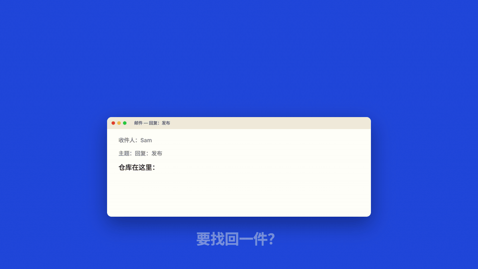
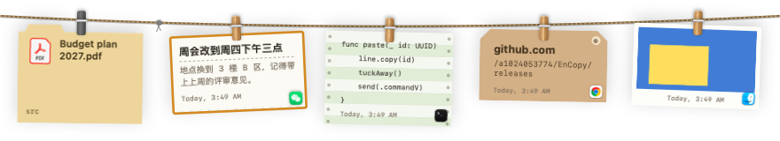
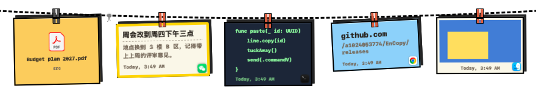
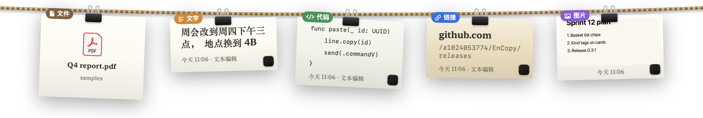
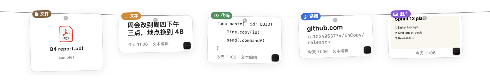
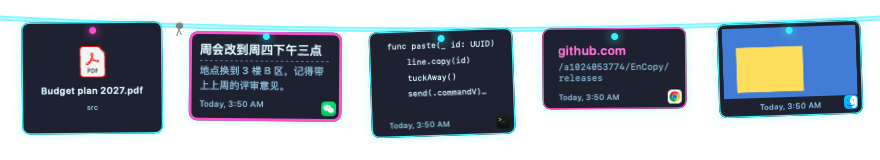
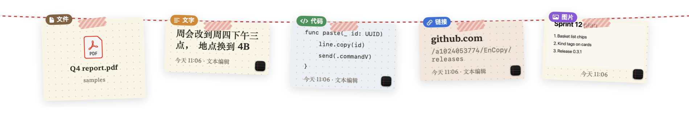
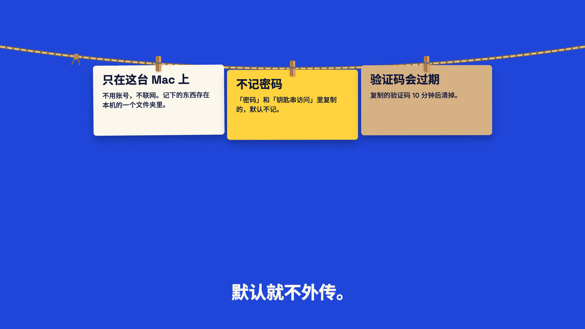

# EnCopy

简体中文 | [English](README.en.md)

<p align="center"><a href="https://a1024053774.github.io/EnCopy/"></a></p>

EnCopy 是 macOS 上的剪贴板 App：复制的东西和截图挂在屏幕顶部的一根绳上，按 ⌥C 把绳子叫下来，用键盘挑一件，贴回正在打字的地方。产品页：<https://a1024053774.github.io/EnCopy/>，网页上就能按 ⌥C 试，也有一段 40 秒的演示。演示也有视频版：[EnCopy-intro.mp4](promo/EnCopy-intro.mp4)（39 秒，英文，带声音）。

它基于 Alejandro Buján 的 [Tendedero](https://github.com/alejandrobujan/tendedero) 修改而来（上游 `3c5b575`，2.0.0，MIT 许可）。EnCopy 是独立的项目，有自己的名字和图标，与 Tendedero 及其作者没有关联，也没有得到其认可。

## 下载

最新版是 [0.2.0](https://github.com/a1024053774/EnCopy/releases/latest)。下载 [EnCopy.dmg](https://github.com/a1024053774/EnCopy/releases/latest/download/EnCopy.dmg)，把 EnCopy 拖进「应用程序」。需要 macOS 14 及以上，Apple 芯片和 Intel 都能用。

这一版没有经过 Apple 公证，第一次打开会被 macOS 拦下：到「系统设置 → 隐私与安全性」，点「仍要打开」。想按 ⏎ 直接贴，在「系统设置 → 隐私与安全性 → 辅助功能」里打开 EnCopy。

## 功能

### ⌥C 挑一件，贴回去



按 ⌥C，绳子落到指针所在的那块屏并拿到键盘，← → 挑一件，⏎ 贴回前台 App。直接贴要「辅助功能」权限，没有的话 ⏎ 只复制，再按 ⌘V。双击一张纸也是直接贴。

⌥C 是唯一的全局快捷键。别的键只在绳子拿到键盘时有效：Tab 只看一种（文字、链接、图片、文件），⇧⏎ 只贴字，⌘Y 快速查看，⌘P 收藏。

### 复制就挂上，一种东西一种纸


复制的文字、链接和代码装好就记，在访达里复制的文件也挂上来，菜单栏里可以暂停。截图也能交给它：截图那一瞬间就挂上绳。

- 文字是小票，代码是打孔纸，链接是吊牌，图片是拍立得，文件是文件夹；木夹和两股麻绳。每张纸右下角是复制它的 App 的图标，也能关掉。
- 收藏的钉在绳结左边，最新的挂在绳结右边第一个，越往右越旧。
- 贴出去、复制出去的那件回到绳头，下次 ⌥C 第一个选中的就是它。同样的内容再复制一遍不会多出一件，原来那件回到绳头；同一张图片再复制也一样，不多存一份。
- 复制了新东西，绳子探出来 1.5 秒；在设置 → 晾衣绳里调成 0.8 到 4 秒，或者关掉。
- 退出重开后都还在。

### 打字就搜，篮子里的也搜得到


绳上挂满后，最老的一件掉进篮子，不进废纸篓；EnCopy 自己存下的截图和复制的图片也一样。⌥C 后直接打字，搜的是绳上和篮子里的全部文字，⏎ 贴出选中的那条：

- 图片按图里识别出的字搜，访达里的图片和视频按文件名搜。
- ⌥C 后绳子右下角挂着「篮子 N 件 ↓」。按 ↓ 或点它，篮子展开成列表：从新到旧一路翻到最早，按今天、昨天、本周、再往前按月分组；每行是一小条对应的纸，跟主题走。↑↓ 一条条看，← → 跳到上一天 / 下一天，打字和 Tab 筛列表，⏎ 贴、⌘P 收藏回绳上。

### 六套主题

纸、像素、拟物、极简、霓虹、手账，纸、夹子和绳子一起换，在设置 → 晾衣绳里挑。

| 纸 | 像素 |
| --- | --- |
|  |  |
| **拟物** | **极简** |
|  |  |
| **霓虹** | **手账** |
|  |  |

### 记什么、留多久



- 每个 App 可以设成照常记、一小时后清、不记，「密码」和「钥匙串访问」默认不记。验证码 10 分钟后清，提前扔掉的也不留在废纸篓里。
- 文字留一年；截图原图 30 天后缩成缩略图，图里的字还能搜；原图合计超过 1 GB 时从最旧的先缩。
- 过期的先进「最近清掉」，7 天内能整批放回。菜单栏「清理历史…」按类型、时间、App、文字手动清一批。

### 动画

动画照设计方案的表：纸按轻重摆，⌥C 拉下和路过滑下各用各的弹簧，偶尔有微风；系统打开「减弱动态效果」时只留淡入淡出。菜单栏图标是一根绳和两个夹子。

## 构建

需要 Swift 工具链，不需要 Xcode。支持 macOS 14 及以上。

```sh
scripts/build-app.sh
open "build/EnCopy Dev.app"
```

这样构建出的是开发版 EnCopy Dev。它是另一个 App，bundle id 是 `app.encopy.EnCopy.dev`，设置、数据文件夹（`~/Library/Application Support/EnCopy Dev/`）和系统权限都记在它自己名下，试用时碰不到日常那份的历史。两份都要占 ⌥C、都会接管截图，不要同时开。试完后，一条命令退出开发版并删掉它的设置和数据文件夹：

```sh
scripts/clean-dev.sh
```

要日常用，装到「应用程序」。脚本会构建日常版（名字 EnCopy，bundle id `app.encopy.EnCopy`），退出正在运行的 EnCopy，再换上新的并打开：

```sh
scripts/install.sh
```

只装了 macOS 27 的 Command Line Tools 时，它带的 SDK 编译不了 SwiftUI，脚本会自动改用旁边的 macOS 26 SDK。

本地构建默认是 ad-hoc 签名。macOS 的权限跟着签名走，所以每次重新构建后，「辅助功能」的开关虽然还亮着，也要关掉再打开才生效。想让授权一直有效，先跑一次：

```sh
scripts/make-signing-identity.sh
```

它在一个单独的钥匙串（`~/Library/Keychains/encopy-signing.keychain-db`）里放一张自签名的代码签名证书，之后 `scripts/build-app.sh` 都用它签名，签名不随重新构建变化。它不动登录钥匙串和钥匙串搜索列表，也不要密码。这个钥匙串的密码是空的，构建才能自己解锁它；因此以你的身份运行的程序都能用它签名，而它只关系到这台 Mac 上系统授给 EnCopy 的权限。

演示动画是 [docs/intro.html](docs/intro.html)，产品页直接放它；视频和上面的图都是从它截出来的，做法见 [promo/x-post.md](promo/x-post.md)。

## 检查

```sh
scripts/check.sh
```

依次检查七件事：代码和脚本里没有上游的名字；全局快捷键只在一处注册；数据文件夹只在一处决定；新复制的东西、截图和监视文件夹里的新文件都按同一条规则决定挂不挂；每句界面文字在简体中文和英文里都有；整个 App 能通过类型检查；再用真实的模型和视图代码跑一遍本地检查。本地检查不依赖 XCTest，用私有剪贴板和一个临时的 home 目录，不碰系统剪贴板，不读写你的 EnCopy 数据，也不看你的截图。

## 贡献者

- [LuckyE](https://github.com/a1024053774)：维护者。定方向、拍板每个决定、发布版本。
- [Claude](https://github.com/claude)（Anthropic 的 AI）：结对写代码和文档。和维护者一起做了 ⌥C 跟着指针换屏、用过的一件回到绳头、0.1.0 和 0.2.0 的发布和产品页，以及上面列的这批 v1 功能和两轮评审的修复。早先的提交里署名为 `Co-Authored-By: Claude`；从 0.2.0 起，Claude 写的提交以 Claude 为作者，维护者是共同作者。
- Devin（Cognition 的 AI）：结对写代码和文档。和维护者一起做了改名换图标、⌥C 叫它来并贴回前台 App、文字进篮子、开发版独立、固定签名，这些提交里署名为 `Co-Authored-By: Devin`。
- [Tendedero](https://github.com/alejandrobujan/tendedero) 的作者 Alejandro Buján 和[上游的贡献者们](https://github.com/alejandrobujan/tendedero/graphs/contributors)：EnCopy 在他们的代码上修改而来。

GitHub 页面上的 Contributors 只统计提交的作者；共同作者显示在每个提交上，不在那一栏里。所以 Claude 早先作为共同作者的提交不计入，0.2.0 起以 Claude 为作者的提交会计入。

## 许可

MIT，见 [LICENSE](LICENSE)，上游的版权声明原样保留。LICENSE 末尾的说明同样有效：Tendedero 的名字和图标不在许可范围内。

## 还没做的

v1 还在做。还开着的：

- 半秒内连着复制两次，现在只记得住后一次；要两次都记下（[T-020](.project-map/tickets/T-020-fast-copies.md)）。
- 刚给「辅助功能」授权后，第一次按 ⏎ 曾经要等一秒多，之后每次都在 0.3 秒内；还要量一次，慢的话查原因（[T-022](.project-map/tickets/T-022-first-paste-after-authorizing.md)）。

先不做的：⌘1 到 ⌘9 和号码贴纸、多选按顺序贴、快捷回复、iCloud 同步、Excel 导入导出、从 iCopy 导入历史，以及简体中文和英文以外的界面语言。

全部计划在[项目地图](.project-map/MAP.md)，设计细节看[设计方案](design/encopy-design.html)。
